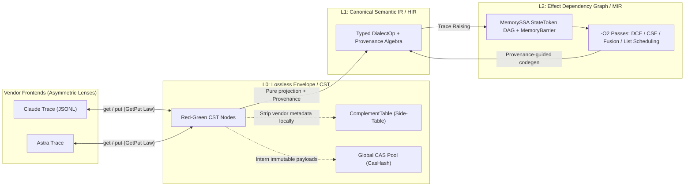

# TraceIR

> **A 3-Layer Session Compiler IR (`L0 CST → L1 HIR → L2 MIR`) for AI Agents in Rust.**

[](https://github.com/ZZzyc001/trace-ir/actions/workflows/ci.yml)
[](#license)

**TraceIR** treats AI Agent session management and cross-agent handoff as a **trace compilation problem** rather than ad-hoc JSON parsing. Inspired by LLVM/MLIR/Rustc multi-level IR design, TraceIR lowers heterogeneous agent execution traces (Claude, Astra, Codex, Devin) through three strictly isolated compiler layers with **zero vendor field leakage**.

---

## Architecture Overview



### Why Three Layers?

1. **L0 (`ir-l0-cst`) — Lossless Envelope Layer**: Preserves vendor-specific timestamps, `reasoning_signature`, raw streaming deltas, and private envelope metadata in a local `ComplementTable` via **Asymmetric Lenses**. Large immutable strings are deduplicated in `cas-store` and passed downward strictly as 32-byte `CasHash` digests.
2. **L1 (`ir-l1-hir`) — Canonical Semantic Layer**: Normalizes heterogeneous agent tools and hooks into strongly typed dialects (`FsRead`, `EditPatch`, `ShellExec`, etc.) with normalized paths (`NormPath`). **Zero-leakage invariant**: `ir-l1-hir` has zero dependency on any vendor crate or `serde_json::Value`; cross-layer lineage is carried solely by lightweight **Provenance Algebra** (`Exact(OriginId)`, `Fused(Vec<OriginId>)`, `Reused(CasHash)`, `Synthesized`).
3. **L2 (`ir-l2-mir`) — Effect Dependency DAG (MemorySSA)**: Raises linear traces into a dependency DAG using monotonic `StateToken(ResourceId, Version)` (e.g., `a.py@v0 → a.py@v1`) and inserts explicit `MemoryBarrier` epochs around opaque side-effecting tools (`ShellExec`). Enables sound `-O2` optimization passes:
   - **DCE**: Prunes failed retry loops and dead error chatter.
   - **CSE**: Collapses redundant read-only queries within the same barrier epoch.
   - **Operator Fusion & List Scheduling**: Packs independent read operations into concurrent `parallel_tool_calls` batches.

---

## Five Theoretical Foundations

| Pillar | Role in TraceIR |
| :--- | :--- |
| **Asymmetric Lenses** | Guarantees `-O0` lossless round-trip via the `GetPut` law (`put(get(raw), complement) == raw`). |
| **Red-Green Trees & Side-Tables** | Keeps untouched turns bit-exact during localized edits or incremental compaction. |
| **Provenance Algebra** | Tracks node lineage across optimization passes (`Exact`, `Fused`, `Reused`, `Synthesized`) without leaking vendor fields downward. |
| **Algebraic Effects / MemorySSA** | Models external workspace mutations as monotonic `StateToken` versions bounded by `MemoryBarrier` epochs. |
| **Trace Raising & List Scheduling** | Bridges linear chat transcripts and parallel DAG execution safely. |

---

## Workspace Layout

```text
crates/
├── cas-store     # Content-addressed immutable blob store (CasHash)
├── ir-l0-cst     # L0 lossless envelope nodes & ComplementTable side-table
├── ir-l1-hir     # L1 typed DialectOp, Provenance algebra, AsymmetricLens trait (zero vendor deps)
├── ir-l2-mir     # L2 MemorySSA DAG, StateToken, -O2 DCE/CSE, parallel batch scheduler
├── lens-claude   # Claude trace frontend/backend AsymmetricLens
├── lens-astra    # Astra trace frontend/backend AsymmetricLens
└── verifier      # L2 barrier/SSA invariant verifier & proptest -O0/-O2 conformance suite
```

---

## Planned Day-1 CLI Experience

```bash
# Lossless cross-agent Context Handoff with -O2 trace compaction & barrier verification
traceir handoff ./claude_session.jsonl --to astra --opt O2 --verify-barriers
```

---

## Running Tests & Verification Gates

```bash
cargo test --workspace
```

CI enforces three hard gates on every push:
1. **Zero-Leakage Dependency Gate**: `ir-l1-hir` and `ir-l2-mir` must never depend on vendor crates or untyped JSON escape hatches.
2. **`-O0` GetPut Lossless Gate (`proptest`)**: Randomized multi-turn traces with dirty deltas and reasoning signatures must round-trip losslessly.
3. **`-O2` MemorySSA & Barrier Gate**: `verify_l2_invariants` asserts monotonic `StateToken` versioning and zero reordering across `MemoryBarrier` epochs.

---

## Roadmap: From Transpiler to Agent-Less Infrastructure

- **Phase 1 (L0 收编)**: Lossless lenses for Claude, Astra, Codex, and Devin to eliminate session lock-in.
- **Phase 2 (L1 统一 ABI)**: Standardize tools, hooks, sandboxes, and permissions into infrastructure-level Syscall Dialects.
- **Phase 3 (L2 Runtime Kernel)**: Move planning DAG compilation, parallel scheduling, state versioning, and CAS caching into a shared runtime kernel—draining heavy proprietary agent shells down to stateless model inference + declarative goals.

## License

Dual-licensed under [MIT](LICENSE-MIT) or [Apache-2.0](LICENSE-APACHE), at your option.
